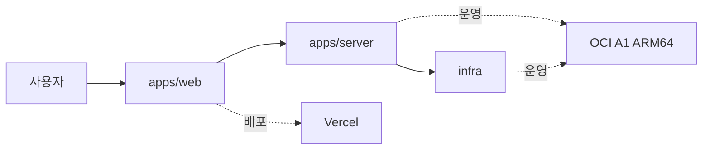

# 줍줍

<p align="center">
  전북대학교 수강신청을 위해 설계한 실시간 여석 알림, 강의 탐색, 시간표 관리 서비스
</p>

<p align="center">
  
  
  
  
</p>

<p align="center">
  <a href="https://zup-zup.com">운영 사이트</a> ·
  <a href="./docs/performance">성능 측정</a>
</p>

줍줍은 수강신청 과정에서 반복 새로고침, 늦은 대응, 흩어진 정보를 줄이기 위해 만든 서비스입니다.  
이 저장소는 사용자 화면, 백엔드 API, 운영 인프라를 하나의 모노레포로 묶어 제품과 운영을 함께 관리합니다.

## 프로젝트 개요

| 항목 | 내용 |
| --- | --- |
| 프로젝트 | 줍줍 |
| 목적 | 전북대 수강신청 경험 개선 |
| 초점 | 실시간성, 명확한 정보, 운영 단순성 |
| 운영 사이트 | [zup-zup.com](https://zup-zup.com) |
| 배포 | Web: Vercel / Server, Infra: OCI A1 ARM64 + Docker |

## 핵심 기능

- 실시간 여석 확인과 알림 흐름
- 강의 검색과 필터링 중심의 UI
- 시간표 기반 판단과 반복 탐색 최소화
- 강의 리뷰와 운영 API 제공

## 아키텍처



## 저장소 구조

| 영역 | 역할 | 위치 |
| --- | --- | --- |
| Web | 검색, 시간표, 리뷰, 알림 UI | [`apps/web`](./apps/web) |
| Server | 강의 수집, 인증, 알림, 운영 API | [`apps/server`](./apps/server) |
| Infra | Docker, 배포, 운영 자원 | [`infra`](./infra) |
| Docs | 의사결정·운영 절차·성능 측정 | [`docs`](./docs) |
| Internal | 작업 메모와 내부 맥락 | [`.agents`](./.agents) |

## 기술 스택

| 구분 | 기술 |
| --- | --- |
| Frontend | Next.js, React, TanStack Query, Zustand, React Hook Form, Zod |
| Backend | Spring Boot, JPA, Security, Redis, Flyway |
| Infra | Docker Compose, MySQL, Redis, Nginx Proxy Manager, DuckDNS |
| 운영 | Vercel, OCI A1 ARM64 |

## 실행 방법

### Web

`apps/web/package-lock.json`을 기준으로 실행합니다.

```bash
cd apps/web
npm ci --legacy-peer-deps
npm run dev
```

### Server

```bash
cd apps/server
./gradlew bootRun
```

### Infra

```bash
cd infra
docker compose up -d
```

## 배포 및 운영

- Web은 Vercel에서 배포합니다.
- Server와 MySQL·Redis는 OCI A1 ARM64 인스턴스의 Docker Compose에서 운영합니다.
- 기존 Nginx Proxy Manager가 80/443 reverse proxy와 HTTPS termination을 담당합니다. NPM 설정·인증서는 저장소와 앱 CD에서 관리하지 않습니다.
- 앱은 호스트의 루프백 포트에 공개합니다. DB와 Redis는 Compose 네트워크에서 연결합니다.
- 배포·롤백 세부 절차는 [운영 배포 문서](./docs/operations/deployment.md)를 따릅니다.

알림은 EMAIL·WEB·DISCORD를 지원하며 웹 푸시는 표준 Push API·VAPID를 사용합니다.

## 테스트와 검증

- Web은 `cd apps/web && npm run test -- --run`으로 Vitest 기반 검증을 수행합니다.
- Server는 `./gradlew check`와 필요 시 별도 `./gradlew migrationTest`, `./gradlew manualTest`, `./gradlew performanceTest`로 검증합니다. `migrationTest`는 Docker의 MySQL Testcontainer를 사용합니다.
- Infra는 `infra/scripts/test-runtime-contract.sh`, `test-local-compose.sh`, CI/CD·rollback contract scripts로 정책을 확인합니다.

## 관련 문서

- [Web README](./apps/web/README.md)
- [Server README](./apps/server/README.md)
- [Infra README](./infra/README.md)
- [운영 절차](./docs/operations)
- [의사결정 기록](./docs/decisions)
- [성능 측정](./docs/performance)
