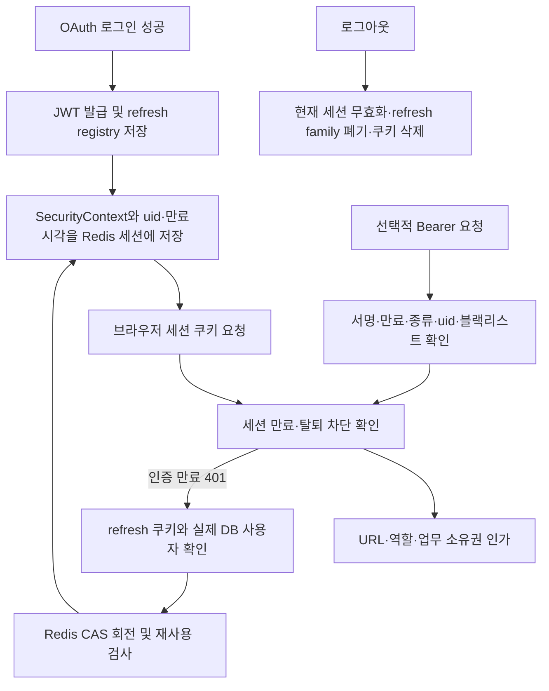

# 인증·인가와 JWT 단순화

이 문서의 JWT 단순화 기록은 `55f04f352`에서 시작해 `c7cc807c4`로 끝난 이전 단계다. 이후 사용자가 Redis 세션 단독 전환을 승인했다. **현재 구현과 API·설정·검증 기준은 [Redis 세션 전환](redis-session-migration.md)**이다. 아래 비교와 검증은 당시 단계의 이력으로 보존하며 현재 JWT 발급·refresh·Bearer 지원을 뜻하지 않는다. 운영 접속·자격 증명 변경·원격 push·병합·배포는 하지 않는다.

## markSuccess의 역할

[CourseCrawlCompletionService.complete](../apps/server/src/main/java/bhoon/sugang_helper/academic/crawling/service/CourseCrawlCompletionService.java)는 강의 동기화 뒤 [CrawlerRunStateService.markSuccess](../apps/server/src/main/java/bhoon/sugang_helper/academic/crawling/service/CrawlerRunStateService.java)를 같은 트랜잭션에서 호출한다. crawler_status의 singleton 행은 latest_status=SUCCESS, last_success_at, updated_at이 바뀐다. 수집 DB 반영이 rollback되면 성공 시각도 함께 rollback된다. 알림 발송 성공은 SeatNotificationDeliverySettlementService.markSent의 별도 상태 전이다.

마지막 성공 시각은 CourseCrawlerService 신선도 검사, AdminService 상태·통계, CrawlerCourseSearchContextProvider의 검색 맥락에 사용된다. 단순 로그만 남기고 markSuccess를 지우면 재시작 후 마지막 성공과 신선도를 잃는다. 이번 인증 작업에서 삭제하지 않는다. 기준 dev `aade57db93f213c98b035f979362075b6f2bf425`에도 같은 클래스·markSuccess 호출이 있었고 CrawlerStatus 엔티티의 필드·변경 본문은 그대로다. CourseCatalogSynchronizer의 서비스 이름과 DTO 패키지·불필요한 조회 인터페이스만 정리됐으며 이번 브랜치에서 성공 기록 동작을 새로 도입한 것이 아니다.

## 실제 인증 흐름

웹은 Axios withCredentials로 쿠키를 보내고 Bearer 헤더를 설정하지 않는다. 서버는 Redis 세션을 이미 사용하면서 자체 access/refresh JWT도 만든다. OAuth 성공 또는 refresh 뒤 JWT에서 읽은 인증 주체·사용자 ID·access 만료시각을 HttpSession에 저장한다. refresh는 HttpOnly 쿠키와 사용자 이메일별 Redis registry로 관리한다. refresh 응답의 JSON 문자열 access JWT는 웹이 사용하지 않지만 기존 API 계약이므로 유지한다. 외부 API 소비자가 있을 수 있는 Bearer 인증도 유지한다.

SecurityContextRepository에 인증을 명시적으로 저장하는 처리는 실제 다음 요청 인증에 필요하다. Spring 공식 문서의 [인증 영속화](https://docs.spring.io/spring-security/reference/servlet/authentication/persistence.html)와 [세션 관리](https://docs.spring.io/spring-security/reference/servlet/authentication/session-management.html)에서도 세션 저장소와 명시적 saveContext의 역할을 구분한다. 이 비교를 이유로 현재 저장소 구성을 바꾸지 않는다.

## 단순화 범위와 보존 계약

- 세 파일에 중복된 v2 refresh 레코드 파싱·직렬화·상수 시간 비교를 패키지 내부 타입으로 통합한다. 원문 토큰 대신 family와 digest를 저장하는 형식은 유지한다. Provider와 보조 처리의 빈 family 허용 차이를 실수로 바꾸지 않는다.
- 같은 JWT의 검증·사용자 ID·인증·만료 추출을 반복 파싱하는 대신 검증된 내부 결과를 재사용한다. 검증하지 않은 getAuthentication 호출로 인증을 대체하지 않는다.
- 호출도 동작도 없는 웹 setAccessToken과 getCookie를 제거한다. 현재 구현이 읽지 않는 쿠키 mock과 동일 동작을 반복하는 테스트 하나를 정리하고, 저장 사용자 복원 뒤 서버 검증은 유지한다.
- 웹의 `401 → refresh 대기 → logout → 이전 refresh 성공`에서 이전 요청을 다시 보내지 않는다. 인증 세대가 바뀌면 재전송을 거부하는 검사만 더하며 같은 세대의 요청 공유·일시 실패 backoff·단일 확정 실패 처리·silent bootstrap 계약은 보존한다.

서명·만료·token_type·uid·권한·blacklist·탈퇴 차단, DB의 사용자 ID+email+미삭제 확인, Redis CAS/TTL과 다른 family 보호, 같은 family 재사용 폐기, logout 뒤 rollback 차단을 유지한다. 회전 이후 세션 또는 쿠키 저장 실패의 보상과 확정 인증 실패/일시 저장소 실패의 쿠키 처리도 보존한다. Redis 실패를 인증 성공으로 바꾸지 않는다. PasswordEncoder·CSRF·쿠키 보안 속성·CORS·기존 보안 경로 규칙은 변경하지 않는다.

웹의 세대 검사는 클라이언트 재전송 방지다. 이미 처리 중인 서버 refresh를 취소하거나 늦은 Set-Cookie를 차단했다는 보장이 아니며, 서버의 family 폐기·회전 경쟁 보호와 구분한다.

## 세션 완전 전환 비교 — 제안만

| 항목 | 현재 혼합 구조 | 세션 전환 시 정해야 할 내용 |
| --- | --- | --- |
| 브라우저 요청 | 이미 서버 세션 쿠키 | 기존 흐름을 계속 쓸 수 있으나 bootstrap·만료 응답·로그아웃을 함께 검증 |
| 추가 상태 | RT registry·회전·재사용 검사·BL/RTR·JWT 만료와 세션 만료 | 자체 JWT와 refresh API를 없앨지, 외부 Bearer 소비자와 전환 기간 확인 |
| 여러 기기 | RT:email 한 registry가 최근 로그인으로 교체됨. 앞 기기 세션은 만료 전 남을 수 있음 | 기기별 세션 유지·현재 기기 로그아웃·탈퇴 시 전체 세션 차단 계약 |
| 만료 | 세션에 access 만료시각을 별도로 저장 | 미사용 만료·활동 갱신·절대 상한·Redis 세션 TTL 정책 |
| 쿠키 보안 | 현재 속성·CORS·CSRF 설정 유지 | 기존 의사결정의 CSRF 토큰 전달과 서버 검증을 함께 전환 |

완전 전환은 토큰 발급 코드만 삭제하는 작업이 아니다. 기존 세션 선택 정책은 과거 재설계 문서에 있지만, 이번 기존 코드 단순화에서 전환 실행은 별도 결정 대상이다. 이 문서는 확정 요청을 대신하지 않는다.

## 검증

기존 JWT·AuthService·Filter·OAuth·권한·CORS 테스트를 유지한다. 브라우저의 늦은 refresh 성공 두 경우를 먼저 추가해 변경 전 실패를 확인한 뒤 guard로 통과시킨다. 실제 JWT provider·세션 저장·인가를 연결한 격리 수명주기 검증과 가짜 API 브라우저 회귀는 역할을 구분한다. 외부 Google OAuth·운영 Redis·실제 자격 증명은 사용하지 않는다. 최종 실행 결과와 커밋은 작업 기록에 추가한다.

## 완료와 검증 결과

- 웹 변경은 `784c720d7`로 커밋했다. 새 race 단위 2건은 변경 전 실패했고 세대 검사 후 통과했다. 웹79파일296건·타입·ESLint 경고0·production build·Playwright6건(retries0,7.0초)이 통과했다. 기존 사용자 복원/확정 실패/일시 오류/동시 refresh 계약은 보존했다. 죽은 쿠키 mock의 중복1건만 제거했다. 새 XHR 관측 테스트는 실행 후 발견된 타입 선언3곳을 보정해 타입검사도 다시 통과했다.
- 서버 refresh 레코드는 공유 최상위 타입 하나로 모았고 provider/폐기·rollback의 기존 빈 family 차이를 보존했다. JWT uid/email/인증/만료/family 결과를 재사용해 Filter의 검증·추출3회 파싱을1회로 줄였다. 서명 검증을 건너뛰는 캐시를 만들지 않았다. 서버가 발급한 토큰의 세션 저장용 parseIssuedAccessToken과 외부 토큰의 종류/BL 검증은 구분한다.
- 검증 결과 재사용으로 DB 조회 도중 만료된 refresh가 갱신되는 회귀를 만들지 않도록 회전·폐기·rollback·세션 저장 경계에서 만료시각을 다시 검사한다. 기존 만료 없는 서명된 refresh의 특이 허용도 임의로 바꾸지 않았다. blacklist는 남은 TTL로 기록하고 token 원문은 새로 저장하지 않는다.
- 집중83건을 통과했다. 새 CAS 경합 테스트의 첫 compareAndDelete(false) mock 누락을 보정했고, 정적 검사의 중복 리터럴3종은 상수로 정리했다. 새 테스트에 규칙 suppress나 skip을 넣어 통과시키지 않았다.
- 전체 서버 clean check bootJar가38초에 성공했다. 124 suite593건 실패/오류/skip0, PMD·Checkstyle main/test 위반0, JAR 생성 완료다. 기존572건에서 legacy/손상/빈family·CAS경합·폐기/rollback·만료 경계와 실제 코드 HTTP 수명주기 검증21건을 보강했다.

AuthenticationFlowTest는 실제 JwtProvider/AuthService/JwtAuthenticationFilter/SecurityConfig/OAuth2SuccessHandler를 연결하고 fake Redis와 사용자 조회, MockMvc를 사용한다. 로그인 성공 handler→세션 인증→만료401→refresh회전→USER의관리자403→logout/기존access·refresh거부, 잘못된서명·만료·종류·uid누락·UA차단을 확인한다. 실제 Google OAuth 교환·Redis 네트워크/Lua/TTL 시간 경과와 실제 브라우저 SESSION 쿠키 전달을 검증한 것은 아니다. 브라우저 테스트도 가짜 API로 UI와 지연 refresh의 요청 재전송 차단을 확인하며 서버 인증 검증과 구분한다.

로그는 TASK/auth-server-baseline.log, auth-server-focused*.log, auth-server-contracts*.log, auth-server-clean.log와 auth-web-before.log, auth-web-focused.log, auth-web-full.log, auth-web-types.log, auth-web-lint.log, auth-web-build.log, auth-web-e2e.log에 있다. 실제 자격 증명·운영 보안 설정·운영 데이터는 변경하지 않았다. 세션 완전 전환·원격 push·병합·배포도 하지 않았다.

부모가 확인한 원격 dev `9e81c0a0adea8ad2c7c8587c92869da55209874f`는 로컬 기준 dev `aade57db93f213c98b035f979362075b6f2bf425`의 조상이다. 이번 작업의 기준을 새로 바꾸거나 브랜치를 병합하지 않았다. markSuccess는 두 기준 모두의 기존 코드이며 이번 JWT 작업에서 수정하지 않았다.

## 후속 승인: Redis 세션 단독 전환

사용자가 “그럼 레디스 세션으로 전환해라”라고 승인하여 자체 JWT 계층과 웹 refresh 재시도를 제거했다. Google 로그인과 Discord 외부 OAuth는 유지한다. 현재 계약은 Redis indexed session 30일 미사용 만료·활동 연장, 현재 기기 로그아웃, 탈퇴 시 같은 사용자 ID의 세션 전체 회수, 매 요청의 현재 DB 사용자·역할 확인, CSRF 토큰 검증이다. 새 namespace 때문에 기존 사용자는 한 번 다시 로그인해야 한다. 이전 JWT 전용 테스트는 더 이상 존재하지 않는 발급·회전·blacklist 구현을 검증하므로 제거하고, 세션 수명주기와 실제 격리 Redis HTTP E2E로 보장 대상을 바꿨다. 결과·전환 설정·미검증 경계는 링크한 최신 문서에 기록한다.
