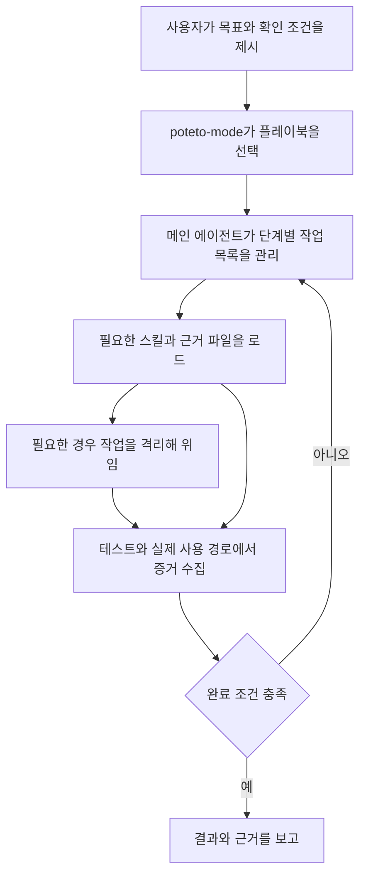

# pstack 하네스 엔지니어링 조사

2026-11-11 기준. Cursor 원본 0.15.36, Codex에서 사용할 수 있는 포트 3개, 줍줍 저장소의 검증 환경을 비교함.

## 요약

pstack은 Lauren Tan(poteto)이 만든 코딩 에이전트용 작업 절차 묶음임. 목표를 입력하면 `poteto-mode`가 작업에 맞는 플레이북을 고르고, 필요한 스킬과 서브에이전트를 호출하도록 지시함. 버그 수정은 기존 증상을 재현한 경로에서 다시 실행하고, 병렬 리뷰는 발견 사항을 명령과 출력으로 검증하는 식임. Cursor가 모델 실행과 도구를 제공하고, pstack이 그 위에서 작업 순서와 종료 조건을 정의함. [원본 소개](https://github.com/cursor/plugins/blob/63912a91d52c43946f974f2aaf661334a6116a82/pstack/README.md) · [Cursor 마켓플레이스](https://cursor.com/marketplace/cursor/pstack)

줍줍에는 이미 `bugfix`, `performance-testing`, `deep-code-review`와 CI 검증이 있음. 겹치는 지침이 많음. 대표 시간표 오류는 **MySQL에서 실제 전환을 재현하는 검증 경로**를 추가하면 기존 검증의 빈틈을 메울 수 있는 사례임. 이 프로젝트에서 pstack의 가치를 먼저 시험할 부분은 작업 유형별 검증 경로, 실행 증거, 완료 조건임. 전체 포트 설치의 효과는 별도로 평가해야 함. [줍줍의 CI](../.github/workflows/ci.yml) · [대표 시간표 재현 기록](performance/2026-11-11-all-api-load-test.md#3-대표-시간표-전환)

## 출처와 구성

원본은 `cursor/plugins` 저장소의 `pstack/`에 있음. Lauren Tan이 올린 최초 PR은 2026-05-23 병합됐음. 아래 수치는 이번 조사에 고정한 트리에서 집계했음. [최초 PR](https://github.com/cursor/plugins/pull/73) · [원본 플러그인 매니페스트](https://github.com/cursor/plugins/blob/63912a91d52c43946f974f2aaf661334a6116a82/pstack/.cursor-plugin/plugin.json)

| 항목 | 원본 0.15.36 기준 |
| --- | --- |
| 공개 스킬 트리 | `skills/`에 `SKILL.md` 58개. 원칙 스킬 24개를 포함함 |
| 플레이북 | `skills/poteto-mode/playbooks/`에 23개. 스킬 58개와 별도 집계임 |
| 서브에이전트 정의 | `poteto-agent`와 `comment-sicko` 2개 |
| 실행 보조 파일 | 플레이북 형식 검사, PR 상태 감시, worktree 점검, 측정·기록용 보조 도구 |
| 별도 자동화 예제 | `automations/benny/`의 Slack 이슈 분류와 재현 워크플로. 스킬 58개 집계에서 제외됨 |
| 라이선스 | MIT |
| 공식 배포 | Cursor 플러그인과 공식 저장소가 생성하는 Claude Code 빌드 |

Claude Code 빌드는 원본 스킬과 에이전트 정의, 가이드를 변환해 `harness/pstack/claude-code/`에 생성함. 해당 트리에는 Benny 자동화와 일부 에셋이 빠짐. 조사한 원본 커밋의 `harness/pstack/`에는 Claude Code 변환만 있었음. 이후 Codex 포트 비교는 각 커뮤니티 저장소의 소스를 기준으로 함. [공식 하네스 트리](https://github.com/cursor/plugins/blob/63912a91d52c43946f974f2aaf661334a6116a82/harness/pstack/README.md) · [Claude Code 어댑터](https://github.com/cursor/plugins/blob/63912a91d52c43946f974f2aaf661334a6116a82/pstack/docs/harness/claude-code.md) · [MIT 라이선스](https://github.com/cursor/plugins/blob/63912a91d52c43946f974f2aaf661334a6116a82/pstack/LICENSE)

| 조사한 저장소 | 고정 커밋 |
| --- | --- |
| Cursor 원본 | [`63912a91`](https://github.com/cursor/plugins/commit/63912a91d52c43946f974f2aaf661334a6116a82) |
| Michael Denyer 포트 | [`bc09365f`](https://github.com/michael-denyer/pstack-claude/commit/bc09365fe61c725c486ba95157fc4048bf8a0b99) |
| mdsmithaustin 포트 | [`5fc2d8b5`](https://github.com/mdsmithaustin/pstack/commit/5fc2d8b5c234d753387d6090f0575176767daf06) |
| finografic 포트 | [`629dc5ea`](https://github.com/finografic/pstack/commit/629dc5ea1c816031125231ca1c647afbc57d2e63) |
| 줍줍 | 로컬 `dev`의 `9cf4ad9fa` |

## 실제 실행 흐름

1. 사용자가 현상, 원하는 동작, 확인할 방법을 설명함. 조사 질문은 Investigation, 결함은 Bug fix, 측정한 병목은 Perf issue 같은 플레이북에 연결됨. Cursor의 커스텀 모드 기능을 사용하면 선택한 스킬을 여러 턴에 유지할 수 있음. [라우팅 가이드](https://github.com/cursor/plugins/blob/63912a91d52c43946f974f2aaf661334a6116a82/pstack/docs/guide/02-poteto-mode.md) · [Cursor 스킬 문서](https://cursor.com/docs/skills)
2. 메인 채팅이 선택한 플레이북의 단계부터 작업 목록에 올림. 건너뛰는 단계는 이유를 남기고, 실제 단계가 필요한 시점에 원칙 파일과 작업 스킬을 읽음. 목록의 각 항목은 LLM이 수행해야 하는 지시임. 단계별 준수 여부는 도구 결과와 별도로 확인해야 함. [poteto-mode](https://github.com/cursor/plugins/blob/63912a91d52c43946f974f2aaf661334a6116a82/pstack/skills/poteto-mode/SKILL.md)
3. 큰 변경에서는 먼저 막힌 작업, 병렬로 할 수 있는 작업, 공유 상태, 필요한 작업 분할을 정함. 같은 파일이나 상태에 여러 쓰기 작업이 필요하면 소유자를 정하고, 독립 산출물은 별도 작업 공간에 맡김. 최종 설계와 검증은 메인 에이전트가 맡음. [Feature 플레이북](https://github.com/cursor/plugins/blob/63912a91d52c43946f974f2aaf661334a6116a82/pstack/skills/poteto-mode/playbooks/feature.md)
4. 메인 에이전트는 결과 보고와 실제 완료를 구분함. 재현 명령, 비교 가능한 측정, 테스트 출력, 스크린샷, Git SHA 등 작업에 맞는 증거가 있어야 다음 단계의 입력으로 쓸 수 있음. PR 작업은 해당 플레이북이 정하는 지점까지 이어짐. [검증과 PR 가이드](https://github.com/cursor/plugins/blob/63912a91d52c43946f974f2aaf661334a6116a82/pstack/docs/guide/06-verify-and-ship.md)

### 도구가 검사하는 것과 모델에 맡기는 것

| 요소 | 실제 역할 | 검증 범위 |
| --- | --- | --- |
| `SKILL.md`, 원칙, 플레이북 | 모델에 조건과 수행 순서를 전달 | 모델이 규칙을 읽고 지키는지는 결과와 실행 기록으로 확인해야 함 |
| `check-plan.mjs` | 다단계 계획의 필수 섹션·체크박스·검증 항목을 파싱하고 위반 시 종료 코드로 표시 | Markdown 구조 검사. 문서에 적힌 검증이 실제로 실행됐는지는 별도 증거가 필요함 |
| `watch-pr` | GitHub 상태를 조회하고 모드에 맞춰 PR 상태를 JSON 또는 사람이 읽는 형태로 반환 | PR·CI·리뷰 상태. 사용자 기능은 해당 커밋에서 별도 검증해야 함 |
| `worktree-audit.sh` | worktree의 크기·변경·병합·PR 신호를 수집해 정리 후보 분류 | 정리 후보를 보고하며, 원격 기준이 지정되면 fetch도 수행함 |
| `show-me-your-work` | 결정·이유·근거 경로·결과를 행으로 남기는 TSV | 다음 사람이 결과를 따라갈 수 있음. 기록의 사실 여부는 실행 결과와 대조해야 함 |
| 호스트 권한과 CI | 읽기·쓰기·네트워크 접근 및 병합 조건을 제어 | 작업에 적용되는 권한과 강제 규칙은 호스트·저장소 설정에 따름 |

[계획 검사 소스](https://github.com/cursor/plugins/blob/63912a91d52c43946f974f2aaf661334a6116a82/pstack/skills/poteto-mode/scripts/check-plan.mjs) · [PR watcher 소스](https://github.com/cursor/plugins/blob/63912a91d52c43946f974f2aaf661334a6116a82/pstack/skills/poteto-mode/scripts/watch-pr/cli.ts) · [worktree 점검 소스](https://github.com/cursor/plugins/blob/63912a91d52c43946f974f2aaf661334a6116a82/pstack/skills/poteto-mode/scripts/worktree-audit.sh) · [결정 기록 스킬](https://github.com/cursor/plugins/blob/63912a91d52c43946f974f2aaf661334a6116a82/pstack/skills/show-me-your-work/SKILL.md)

### 플레이북 23개

| 업무 | 플레이북과 완료 조건 |
| --- | --- |
| 읽기 전용 조사 | **Investigation**은 코드·이력을 따라 설명함. **Runtime forensics**는 현재 실행 중인 증상을 계측하고, **Trace forensics**는 이미 수집된 프로파일·덤프를 해석함 |
| 수정과 구현 | **Bug fix**는 동일 경로 재현과 수정 후 재검증, **Feature**는 동작·설계·검증, **Refactoring**은 동작 보존을 목표로 함 |
| 성능 | **Perf issue**는 병목의 일회성 수정, **Hillclimb**은 목표 지표를 고정하고 가설을 여러 번 비교하는 작업임 |
| 설계 실험 | **Prototype**은 관찰 가능한 선택지를 작은 실험으로 판별함. **Visual parity**는 두 UI의 시각적 동등성을 확인함 |
| 에이전트 지침 개선 | **Authoring a skill**은 스킬 작성·수정, **Eval**은 지침 변경 효과를 블라인드 비교함 |
| PR 관리 | **Opening a PR**은 커밋·설명·PR을 정리함. **Babysit**은 충돌·리뷰·CI를 처리해 merge-ready까지 관찰함. **Shipping**은 독립 검증을 통과한 PR을 승인 범위 안에서 병합함 |
| 장기 작업 | **Autonomous run**은 단일 종료 조건까지 반복, **Orchestrate**는 여러 작업의 소유자와 진행을 관리함. **Multi-phase plan**은 의존하는 단계와 검증 계획을 남김 |
| 여러 PR | **Autopilot-full**은 원본에서 승인된 범위의 독립 PR을 검증한 뒤 병합까지 진행함. **Autopilot-stack**은 현재 head 검증과 인계에서 멈춤 |
| 인계와 정리 | **Session pickup**은 이전 실행을 이어받고, **Pause safely**는 중단 지점을 남김. **Worktree cleanup**은 삭제 전 변경·원격·PR 상태를 확인함 |

[원본 플레이북 목록](https://github.com/cursor/plugins/tree/63912a91d52c43946f974f2aaf661334a6116a82/pstack/skills/poteto-mode/playbooks) · [Autonomous run](https://github.com/cursor/plugins/blob/63912a91d52c43946f974f2aaf661334a6116a82/pstack/skills/poteto-mode/playbooks/autonomous-run.md) · [Autopilot-full](https://github.com/cursor/plugins/blob/63912a91d52c43946f974f2aaf661334a6116a82/pstack/skills/poteto-mode/playbooks/autopilot-full.md) · [Autopilot-stack](https://github.com/cursor/plugins/blob/63912a91d52c43946f974f2aaf661334a6116a82/pstack/skills/poteto-mode/playbooks/autopilot-stack.md)

## 차이가 드러나는 스킬

### 조사와 설계

- `how`는 현재 코드에서 호출과 데이터 흐름을 추적함. `why`는 커밋이나 논의에서 당시 이유를 찾음. `teach`는 둘을 바탕으로 동작과 선택의 배경을 설명하고, `recall`은 중단한 작업의 맥락을 복원함. 각 입력 출처가 답할 수 있는 질문이 다르므로 현재 코드에서 동작을 보고, 과거 기록에서 의도를 확인하는 편이 정확함. [코드 이해 가이드](https://github.com/cursor/plugins/blob/63912a91d52c43946f974f2aaf661334a6116a82/pstack/docs/guide/03-understand.md)
- `architect`는 호출부와 타입·모듈 경계를 먼저 그린 뒤 서로 다른 구조의 후보를 비교함. `arena`를 써서 최소 두 후보를 만들고, 유지보수자가 알아야 할 내부 지식과 공개 인터페이스 크기를 비교함. 적용 과정에서 같은 종류의 우회가 반복되면 설계를 다시 검토함. [Architect](https://github.com/cursor/plugins/blob/63912a91d52c43946f974f2aaf661334a6116a82/pstack/skills/architect/SKILL.md)
- `arena`는 같은 문제를 각 후보에게 주고 서로의 결과를 보기 전까지 산출물을 격리함. 평가 기준은 판정 단계에 사용함. 가능하면 메인과 다른 모델 계열의 판정자가 결과를 비교함. 우수한 후보를 바탕으로 필요한 부분만 합친 뒤 결과를 재검증함. [Arena](https://github.com/cursor/plugins/blob/63912a91d52c43946f974f2aaf661334a6116a82/pstack/skills/arena/SKILL.md)

### 병렬 작업과 리뷰

| 스킬 | 에이전트에게 주는 일 | 결과 |
| --- | --- | --- |
| `swarm` | 기능·파일을 나누거나 같은 질문을 여러 번 수행. 완료 조건과 검증할 SHA를 브리프에 포함 | 범위별 결과와 누락을 합침. 동일 작업을 경쟁시킬 때는 선택 기준을 먼저 선언 |
| `arena` | 같은 과제의 대안 설계 또는 구현을 독립 생성 | 하나의 설계·구현과 선택 이유 |
| `interrogate` | 같은 변경을 독립적으로 반박하고, 명령·관측 출력·기대 출력으로 결함을 입증 | 실제 명령을 다시 실행해 남은 발견 사항. 동일 원인을 합침 |

최근 줍줍에서 진행한 12명 리뷰는 동일한 프롬프트를 쓰되 에이전트 이름으로 관점과 우선 범위를 나눴음. pstack 기준으로는 `swarm`의 범위 분할과 `interrogate`의 독립 재검증을 함께 사용한 형태에 가까움. 같은 모델의 별도 세션은 독립적인 탐색을 늘릴 수 있지만, 다른 모델 계열을 사용한 비교라는 증거는 따로 필요함. [Swarm](https://github.com/cursor/plugins/blob/63912a91d52c43946f974f2aaf661334a6116a82/pstack/skills/swarm/SKILL.md) · [Interrogate](https://github.com/cursor/plugins/blob/63912a91d52c43946f974f2aaf661334a6116a82/pstack/skills/interrogate/SKILL.md)

`interrogate` 원본은 실제 실행으로 입증한 발견만 남기는 기준을 둠. 실행할 수 있는 기능 회귀에 특히 적합함. 줍줍의 `deep-code-review`는 명확한 호출 경로와 도달 조건을 독립 검증한 B 등급도 인정함. 배포 환경의 권한·설정처럼 직접 실행이 어려운 리뷰는 이 차이가 결과에 영향을 줌. [Interrogate](https://github.com/cursor/plugins/blob/63912a91d52c43946f974f2aaf661334a6116a82/pstack/skills/interrogate/SKILL.md)

### 테스트와 검증

- **Bug fix와 TDD.** 실제 문제가 난 API·UI·CLI에서 실패를 먼저 확보함. 원인 후보를 관측으로 배제하고, 수정 후 같은 경로로 결과를 확인함. 재현이 저렴할 때는 실패 테스트를 먼저 만든 뒤 고침. 원본 플레이북은 실패 재현과 수정의 커밋 순서도 제안하므로, 모든 커밋이 녹색이어야 하는 저장소는 로컬 실패 증거와 PR의 커밋 경계를 따로 정해야 함. [Bug fix](https://github.com/cursor/plugins/blob/63912a91d52c43946f974f2aaf661334a6116a82/pstack/skills/poteto-mode/playbooks/bug-fix.md) · [TDD](https://github.com/cursor/plugins/blob/63912a91d52c43946f974f2aaf661334a6116a82/pstack/skills/tdd/SKILL.md)
- **프로젝트 검증 스킬.** `create-verification-skill`은 시작·준비 확인·사용자 동작·증거·정리를 저장소에 맞춰 기록함. 실제 사용자 동작을 시작할 수 있는 상태까지 준비 여부를 확인함. 생성된 절차를 한 기능에서 처음부터 끝까지 실행하고 정리 뒤 증거가 남는지 확인함. [검증 스킬 생성](https://github.com/cursor/plugins/blob/63912a91d52c43946f974f2aaf661334a6116a82/pstack/skills/create-verification-skill/SKILL.md)
- **형식 검증.** 동시 실행 순서나 상태 불변식을 검증할 때 모델 검사기, 증명기, SMT 등 문제에 맞는 도구를 선택함. 모델에 넣은 원자적 단계가 코드에서도 원자적인지 대응시키고, 잘못된 변형이 실제로 탐지되는지 확인함. TLA+ 같은 모델의 통과 범위는 모델에 포함한 상태·가정·범위로 한정됨. [형식 검증 스킬 생성](https://github.com/cursor/plugins/blob/63912a91d52c43946f974f2aaf661334a6116a82/pstack/skills/create-formal-verification-skill/SKILL.md)
- **성능 측정.** 병목과 튜닝 상태, 물리적 상한, 오류, 반복 가능성, 실제 사용자 경로에서의 비중, 측정 구간에서 일이 실제로 실행됐는지를 확인함. 옵션 비교에서 교차 순서로 각 조건을 최소 다섯 번 실행하라는 원본 기준은 CPU나 캐시 온도가 시간에 따라 달라지는 실험에서 유용함. [Benchmark checklist](https://github.com/cursor/plugins/blob/63912a91d52c43946f974f2aaf661334a6116a82/pstack/skills/benchmark-checklist/SKILL.md) · [Hillclimb](https://github.com/cursor/plugins/blob/63912a91d52c43946f974f2aaf661334a6116a82/pstack/skills/poteto-mode/playbooks/hillclimb.md)

### 장기 실행과 피드백

- 장기 작업은 확인 가능한 종료 조건을 먼저 정하고, 시도마다 근거·진행·되돌림 여부를 남김. `show-me-your-work`의 TSV는 의사결정 기록임. 단계 체크박스는 실행 상태, 테스트와 trace는 관측값으로 쓰여 각각 역할이 다름. [Autonomous run](https://github.com/cursor/plugins/blob/63912a91d52c43946f974f2aaf661334a6116a82/pstack/skills/poteto-mode/playbooks/autonomous-run.md) · [결정 기록](https://github.com/cursor/plugins/blob/63912a91d52c43946f974f2aaf661334a6116a82/pstack/skills/show-me-your-work/SKILL.md)
- `reflect`는 현재 작업의 대화 기록에서 반복된 시행착오를 찾아 가이드를 고침. `correct`는 반복되는 실수를 재현 가능한 구조로 막을 수 있는지 검토함. 예를 들어 모듈 간 금지 import는 문구를 추가하는 것보다 린트로 실패시킬 수 있음. 단일 프로젝트의 특수 조건은 저장소 규칙으로 남길 수 있음. [Reflect](https://github.com/cursor/plugins/blob/63912a91d52c43946f974f2aaf661334a6116a82/pstack/skills/reflect/SKILL.md) · [Correct](https://github.com/cursor/plugins/blob/63912a91d52c43946f974f2aaf661334a6116a82/pstack/skills/correct/SKILL.md)
- `eval`은 동일한 사용자 요청을 서로 격리된 후보에게 전달하고, 판정자가 모델이나 조건을 모른 채 산출물을 비교하게 함. 후보가 스킬을 따랐다는 자기 보고와 실제 스킬 본문을 읽었다는 실행 기록을 구분함. [Eval 플레이북](https://github.com/cursor/plugins/blob/63912a91d52c43946f974f2aaf661334a6116a82/pstack/skills/poteto-mode/playbooks/eval.md)
- 원본의 Benny는 Slack 이슈 분류와 재현·작은 수정 초안 준비용으로 분리된 자동화 예제임. 파일을 대상 프로젝트에 준비하고 자동화 초안을 별도로 검토·활성화하는 흐름임. 일상적인 로컬 조사나 검증에는 이 자동화가 관여하지 않음. [Benny 설정](https://github.com/cursor/plugins/blob/63912a91d52c43946f974f2aaf661334a6116a82/pstack/automations/benny/README.md)

### 원칙 24개의 쓰임

| 묶음 | 원칙과 실제 적용 |
| --- | --- |
| 작업을 작게 만들기 10개 | 작은 변경(`laziness-protocol`), 자료 구조 먼저(`foundational-thinking`), 요구부터 다시 설계(`redesign-from-first-principles`), 실패한 가정 검증(`attack-the-premise`), 제거부터 검토(`subtract-before-you-add`), 읽는 비용 줄이기(`minimize-reader-load`), 목표 구조로 수렴(`outcome-oriented-execution`), 사용자 경험(`experience-first`), 대안 실험(`exhaust-the-design-space`), 재실행 가능한 도구(`build-the-lever`) |
| 상태와 경계 6개 | 도메인 모델링(`model-the-domain`), 경계 입력 검증(`boundary-discipline`), 타입으로 유효 상태 표현(`type-system-discipline`), 멱등 처리(`make-operations-idempotent`), 호출자 이관과 레거시 제거(`migrate-callers-then-delete-legacy-apis`), 공유 상태 분리 후 필요 시 직렬화(`separate-before-serializing-shared-state`) |
| 검증 5개 | 실제 동작 확인(`prove-it-works`), 근본 원인 수정(`fix-root-causes`), 검증 가능한 단위(`sequence-verifiable-units`), 관찰 가능한 동작 테스트(`test-behavior-not-implementation`), 숫자의 원인과 한계 설명(`explain-the-number`) |
| 위임과 축적 3개 | 컨텍스트 절약(`guard-the-context-window`), 판단 가능한 작업 진행(`never-block-on-the-human`), 배운 규칙을 린트·테스트·스크립트로 옮기기(`encode-lessons-in-structure`) |

원칙은 지시 파일을 짧게 유지하는 수단임. 변경과 관계있는 원칙만 자세히 읽고, 실제 위반을 판정할 수 있는 조건은 CI에 넣을수록 재사용하기 쉬움. [원본 원칙 안내](https://github.com/cursor/plugins/blob/63912a91d52c43946f974f2aaf661334a6116a82/pstack/docs/guide/08-principles.md) · [구조로 규칙을 옮기는 원칙](https://github.com/cursor/plugins/blob/63912a91d52c43946f974f2aaf661334a6116a82/pstack/skills/principle-encode-lessons-in-structure/SKILL.md)

## Codex에서 사용할 수 있는 배포판

포트가 스킬을 제공한다는 사실, 해당 스킬을 호스트가 검색할 수 있다는 사실, 실행에 필요한 도구와 권한이 준비됐다는 사실을 따로 확인해야 함. 같은 이름의 `poteto-mode`라도 기본 역할, 모델 매핑, 훅, 병합 권한이 다를 수 있음. 아래 비교는 각 포트의 README와 실행 관련 소스에 고정한 내용임.

| 배포판 | 구성과 시작 방식 | 적용할 때 생기는 차이 |
| --- | --- | --- |
| **Cursor 원본 0.15.36** | Cursor 마켓플레이스에서 플러그인 설치. `/setup-pstack`과 `/poteto-mode`를 사용 | Cursor의 모델 역할 설정과 Task, 커스텀 모드, `/loop` 등을 사용. 브라우저·CLI 조작과 `deslop`은 일부 단계에서 별도 `cursor-team-kit`에 의존 |
| **michael-denyer/pstack-claude 0.9.135** | Codex 플러그인 매니페스트와 `SessionStart` 훅이 있음. 훅을 쓰는 설치와 개별 스킬만 설치하는 방식이 있음 | Claude Code 중심 스킬 표현을 Codex 도구에 매핑. 훅 신뢰가 설정된 경우 시작·재개 등에서 라우팅 지시를 주입. 포트의 Autopilot-full은 사람이 병합하도록 동작을 바꿈 |
| **mdsmithaustin/pstack** | `npx skills`로 배포하는 스킬 묶음. `pstack-harness`가 CLI별 도구·모델·페르소나 매핑을 제공 | 모델 설정을 사용자·저장소와 CLI별로 나눌 수 있음. 스킬 로드와 네이티브 에이전트 등록은 별개임. 단계 복구, 실행 결과 확인, 스킬 평가 도구가 추가돼 있음 |
| **finografic/pstack** | 18개 이식형 스킬과 21개 원칙을 정리한 저장소. 필요한 스킬을 개별 사용 | `poteto-mode` 라우터와 전용 `arena`·`swarm`·`interrogate`, 역할별 모델 설정을 배포 범위에서 뺌. 검증·문서·설계 단위로 쓰기 쉬우며 원본의 자동 라우팅을 기대하면 기능 차이가 큼 |

[원본 설치와 의존성](https://github.com/cursor/plugins/blob/63912a91d52c43946f974f2aaf661334a6116a82/pstack/README.md) · [Denyer 설치](https://github.com/michael-denyer/pstack-claude/blob/bc09365fe61c725c486ba95157fc4048bf8a0b99/README.md#install) · [Denyer Codex 매니페스트](https://github.com/michael-denyer/pstack-claude/blob/bc09365fe61c725c486ba95157fc4048bf8a0b99/plugins/pstack/.codex-plugin/plugin.json) · [Denyer 병합 정책](https://github.com/michael-denyer/pstack-claude/blob/bc09365fe61c725c486ba95157fc4048bf8a0b99/plugins/pstack/skills/poteto-mode/playbooks/autopilot-full.md) · [mdsmithaustin 포트 설명](https://github.com/mdsmithaustin/pstack/blob/5fc2d8b5c234d753387d6090f0575176767daf06/PORTING.md) · [finografic 포트 차이](https://github.com/finografic/pstack/blob/629dc5ea1c816031125231ca1c647afbc57d2e63/README.md#what-this-fork-does-differently)

### 실행 호스트에서 달라지는 것

1. **역할과 모델.** Cursor 원본은 `setup-pstack`으로 역할별 모델을 고름. 원본 예시에는 코드 작업과 어려운 판단이 서로 다른 모델 계열에 배정돼 있음. Codex 포트는 실제 세션에서 선택할 수 있는 모델과 추론 옵션으로 치환함. 목록에 적힌 모델은 실행 계정에서 고를 수 있을 때만 유효함. [원본 모델 설정](https://github.com/cursor/plugins/blob/63912a91d52c43946f974f2aaf661334a6116a82/pstack/skills/setup-pstack/SKILL.md) · [Denyer 도구 매핑](https://github.com/michael-denyer/pstack-claude/blob/bc09365fe61c725c486ba95157fc4048bf8a0b99/plugins/pstack/skills/poteto-mode/references/codex-tools.md) · [mdsmithaustin Codex 어댑터](https://github.com/mdsmithaustin/pstack/blob/5fc2d8b5c234d753387d6090f0575176767daf06/skills/pstack-harness/references/codex.md)
2. **병렬 수와 격리.** 같은 리뷰어 프롬프트를 몇 번 전달할지와 몇 개가 동시에 실행될지는 별개임. 동시 실행 한도는 세션 도구가 정함. 스킬이 요구하는 별도 worktree도 호스트에 Git 메타데이터 쓰기 권한이 있어야 만들 수 있음. 이 채팅의 이전 12명 리뷰가 나눠 실행된 것도 같은 제약의 예임. [mdsmithaustin의 Codex 제한과 격리](https://github.com/mdsmithaustin/pstack/blob/5fc2d8b5c234d753387d6090f0575176767daf06/skills/pstack-harness/references/codex.md) · [원본 Swarm](https://github.com/cursor/plugins/blob/63912a91d52c43946f974f2aaf661334a6116a82/pstack/skills/swarm/SKILL.md)
3. **자동 라우팅.** Denyer는 `codex-hooks.json`에서 시작·재개·대화 초기화·컨텍스트 압축 이벤트를 설정하고 셸 훅으로 라우팅 문구를 전달함. 스킬만 복사하는 경우 그 훅은 포함되지 않음. mdsmithaustin은 스킬 호출 정책과 CLI별 등록 상태를 구분함. 자동 적용 여부는 실제 세션에서 어떤 지침이 로드되는지 확인해야 함. [Denyer 훅 설정](https://github.com/michael-denyer/pstack-claude/blob/bc09365fe61c725c486ba95157fc4048bf8a0b99/plugins/pstack/hooks/codex-hooks.json) · [Denyer 훅 소스](https://github.com/michael-denyer/pstack-claude/blob/bc09365fe61c725c486ba95157fc4048bf8a0b99/plugins/pstack/hooks/session-start.sh) · [mdsmithaustin 시작·복구 규칙](https://github.com/mdsmithaustin/pstack/blob/5fc2d8b5c234d753387d6090f0575176767daf06/skills/poteto-mode/SKILL.md)
4. **오래 걸리는 실행.** 원본은 Cursor `/loop`와 감시를 이용함. 포트에서 같은 기능을 쓰려면 호스트가 제공하는 재개·예약·이벤트를 사용하거나 수동 단계로 옮겨야 함. 활성 프로세스 확인, 종료 조건, 재개 시점은 각각 검증해야 함. [원본 Autonomous run](https://github.com/cursor/plugins/blob/63912a91d52c43946f974f2aaf661334a6116a82/pstack/skills/poteto-mode/playbooks/autonomous-run.md) · [Denyer의 Codex 드라이버 매핑](https://github.com/michael-denyer/pstack-claude/blob/bc09365fe61c725c486ba95157fc4048bf8a0b99/plugins/pstack/skills/poteto-mode/references/codex-tools.md)

### 사용 범위와 비용

- 저장소 규칙이 먼저임. 원본의 수정 플레이북은 PR 열기 단계로 이어지고, 자율 작업 규칙은 일부 외부 조치를 폭넓게 다룸. 프로젝트 검증만 원할 때는 허용 범위를 명시해야 함. 사용자가 요청한 설치·쓰기·커밋·PR·배포 권한을 포트 문구에서 추론하면 안 됨. [원본 Autonomy와 플레이북](https://github.com/cursor/plugins/blob/63912a91d52c43946f974f2aaf661334a6116a82/pstack/skills/poteto-mode/SKILL.md) · [PR 열기 절차](https://github.com/cursor/plugins/blob/63912a91d52c43946f974f2aaf661334a6116a82/pstack/skills/poteto-mode/playbooks/opening-a-pr.md)
- 작은 변경에 설계 후보 여러 개, 대규모 리뷰, 전체 라이브 검증을 항상 적용하면 판단 비용과 대기 시간이 늘어남. 테스트 가능한 단위로 쪼개고 변경 위험에 맞춰 리뷰 범위를 고르는 편이 실제 효과를 비교하기 쉬움. `swarm` 보고서에는 누락 범위를, `arena` 보고서에는 선택 이유를 남기므로 무조건 같은 수의 에이전트를 실행할 필요가 없음. [Swarm](https://github.com/cursor/plugins/blob/63912a91d52c43946f974f2aaf661334a6116a82/pstack/skills/swarm/SKILL.md) · [Arena](https://github.com/cursor/plugins/blob/63912a91d52c43946f974f2aaf661334a6116a82/pstack/skills/arena/SKILL.md)
- 자동 시작 훅, PR watcher, transcript 조회는 단순한 문서 열기보다 접근 범위가 넓음. 원본 watcher는 Bun을 사용하고 부트스트랩 과정에서 lockfile 기반 의존성 설치를 할 수 있음. Denyer는 포트가 자체 텔레메트리를 보내지 않는다고 설명하지만, 에이전트가 읽은 대화 기록은 사용하는 모델 제공자에 전달될 수 있다고 밝힘. 도입할 때는 읽을 대화 범위, 스크립트 권한, PR 자격증명과 실행 버전을 따로 확인할 필요가 있음. [watch-pr 진입점](https://github.com/cursor/plugins/blob/63912a91d52c43946f974f2aaf661334a6116a82/pstack/skills/poteto-mode/scripts/watch-pr/watch-pr) · [원본 부트스트랩](https://github.com/cursor/plugins/blob/63912a91d52c43946f974f2aaf661334a6116a82/pstack/skills/poteto-mode/scripts/bootstrap.ts) · [Denyer 데이터 처리](https://github.com/michael-denyer/pstack-claude/blob/bc09365fe61c725c486ba95157fc4048bf8a0b99/README.md#data-handling)
- 출력에 검증 기록이 있어도 무엇을 실행했는지가 더 중요함. `check-plan`이 문서 형식을 통과시켰다는 결과와 해당 커밋에서 DB 회귀 테스트가 통과했다는 결과의 의미가 다름. 스킬은 범위를 결정하고 재현을 지시하며, 실행 명령과 관측된 결과가 결함과 수정에 대한 증거가 됨. [계획 형식 검사](https://github.com/cursor/plugins/blob/63912a91d52c43946f974f2aaf661334a6116a82/pstack/skills/poteto-mode/scripts/check-plan.mjs) · [실제 검증 원칙](https://github.com/cursor/plugins/blob/63912a91d52c43946f974f2aaf661334a6116a82/pstack/skills/principle-prove-it-works/SKILL.md)

## 효과에 대해 확인할 수 있는 범위

mdsmithaustin의 2026-10-19 공개 비교에서는 기본 Codex, 최소한으로 적응시킨 원본, 해당 Codex 포트를 3개 과제에서 각각 2회 반복했음. 첫 구현과 후속 변경을 합친 **36개 실행 단계가 모두 통과**했음. 세 방식의 통과율은 같았고, 실험 중 `poteto-mode`를 명시적으로 호출한 실행은 없었음. [포트의 비교 설계와 결과](https://github.com/mdsmithaustin/pstack/blob/5fc2d8b5c234d753387d6090f0575176767daf06/evals/port-value/results/2026-10-19.md)

| 같은 실험에서 관측한 값 | 기본 Codex | 원본 적응판 | mdsmithaustin 포트 |
| --- | ---: | ---: | ---: |
| 구현·후속 변경 모두 통과 | 6/6 | 6/6 | 6/6 |
| CLI 입력 토큰 합계 | 1,635,247 | 1,541,349 | 4,294,087 |
| CLI 실행 시간 중앙값 | 72.963초 | 69.416초 | 139.144초 |

해당 포트에서 이 표본의 입력 토큰과 실행 시간이 늘었음. 표본이 작고 입력 토큰에 캐시 분량이 들어 있으며, 상위 에이전트 사용량에 하위 작업이 얼마나 포함되는지 확정되지 않았음. 모델 비용이나 다른 프로젝트의 성능으로 환산할 수 없음. 2026-11-08의 별도 `verify-commands` 소규모 실험에서도 양쪽 모두 2/2였음. 두 실험은 해당 포트가 공개한 결과임. [10월 비교의 사용량과 해석](https://github.com/mdsmithaustin/pstack/blob/5fc2d8b5c234d753387d6090f0575176767daf06/evals/port-value/results/2026-10-19.md) · [11월 소규모 실험](https://github.com/mdsmithaustin/pstack/blob/5fc2d8b5c234d753387d6090f0575176767daf06/evals/results/2026-11-08-eval-efficiency.md)

공개된 기능과 효과는 따로 평가할 필요가 있음. 스킬의 계획 형식, 평가 스크립트, 모델 역할 설정이 존재하는 것은 코드에서 확인 가능함. 그것이 결함 탐지나 수정 성공률을 높이는지는 비교하려는 작업의 기준선과 실패가 검출되는 실험으로 봐야 함. [원본 Eval 절차](https://github.com/cursor/plugins/blob/63912a91d52c43946f974f2aaf661334a6116a82/pstack/skills/poteto-mode/playbooks/eval.md)

## 줍줍 저장소와 대조

OpenAI가 공개한 하네스 엔지니어링 사례에서는 짧은 `AGENTS.md`를 문서의 목차로 쓰고, 구조 규칙과 검증을 코드·린트·CI에 넣는 방식을 설명함. pstack은 그중 작업을 고르고 위임하며 검증하는 절차를 제공함. 서비스별 테스트 데이터, 실제 시스템 진입점, 로그·상태 관측, 배포 권한은 프로젝트 쪽에 있어야 함. [OpenAI 하네스 엔지니어링 사례](https://openai.com/index/harness-engineering/) · [pstack 검증 스킬 생성](https://github.com/cursor/plugins/blob/63912a91d52c43946f974f2aaf661334a6116a82/pstack/skills/create-verification-skill/SKILL.md)

| 항목 | 줍줍에 있는 것 | 이 프로젝트에서 검토할 수 있는 보완 |
| --- | --- | --- |
| 규칙 탐색 | 짧은 `AGENTS.md`, 코드 컨벤션, 모듈·운영 문서 | 처음 보는 에이전트가 주요 기능의 실제 검증 명령과 결과 위치를 바로 찾게 함 |
| 코드 경계 | Spring Modulith 검증과 프런트 ESLint 의존성 규칙 | 추가 지침은 반복 위반이 확인된 경계부터 실행 가능한 검사로 옮김 |
| 환경별 테스트 | Gradle 단위·MySQL 마이그레이션·모듈 HTTP E2E·Redis 세션, Vitest·Playwright, 인프라 계약 테스트 | 기능별로 어느 환경을 써야 실패가 드러나는지 연결. 테스트 명령의 녹색 여부와 재현 목적을 함께 기록 |
| 리뷰 | 필수 관점, 위험별 추가 관점, 독립 반증과 근거 등급 | 기준 커밋, 실행 명령과 관찰 결과를 함께 전달. 같은 프롬프트의 반복과 다른 모델 비교를 구분 |
| 성능 | API 부하 보고서, SQL·HTTP 호출 수와 브라우저 렌더링 기록 | 입력 데이터와 실행기를 다시 확보할 수 있는 위치, 성공 요청과 누락 요청, 반복 범위, 병목 측정치를 같이 보관 |
| 팀 공유 | 주요 문서와 CI는 Git에 있고 `.agents/skills/`는 Git에서 제외됨 | 재현과 검증 명령 중 팀에 필요한 내용은 추적되는 문서·테스트·스크립트에 두는 방식이 적합함 |

[줍줍 에이전트 지침](../AGENTS.md) · [모듈 구조 검증](../apps/server/src/test/java/bhoon/sugang_helper/modularity/ApplicationModulesTest.java) · [프런트 의존성 규칙](../apps/web/eslint.config.mjs) · [CI](../.github/workflows/ci.yml) · [Git 제외 경로](../.gitignore) · [API 부하 보고서](performance/2026-11-11-all-api-load-test.md)

### 대표 시간표 오류에 적용하는 예

이 사례의 완료 조건은 실제 MySQL에서 기존 대표가 있는 사용자가 새 대표를 선택할 수 있고, 커밋된 상태에서 해당 사용자의 대표가 하나라는 것임. 조회 API와 DB 행을 함께 관찰하면 기존 단위 테스트가 확인하는 Java 객체 상태와 실제 저장 결과를 구분할 수 있음. [시간표 API](../apps/server/src/main/java/bhoon/sugang_helper/planning/timetable/controller/TimetableController.java#L76) · [기존 테스트](../apps/server/src/test/java/bhoon/sugang_helper/planning/timetable/service/TimetableServiceTest.java#L165)

| 단계 | 확인할 증거 |
| --- | --- |
| 재현 | 격리 MySQL과 합성 사용자에 대표 A, 비대표 B를 생성. 인증된 `PATCH /api/v1/timetables/{id}/primary`의 응답, 중복 제약, 요청 뒤 DB 상태를 수집 |
| 원인 확인 | 실제 SQL 반영 순서를 관찰해 이전 대표 해제와 새 대표 지정이 어느 순서로 DB에 도달하는지 확인. Hibernate의 flush에서 발생한 UPDATE를 직접 기록 |
| 수정 범위 결정 | 대표 전환의 트랜잭션과 같은 불변식을 사용하는 생성·삭제 경로를 확인. 요청 범위에 해당하는 변경만 정하고 사용자 간 소유권과 오류 응답을 함께 확인 |
| 회귀 검증 | 기존 재현이 통과하고 최종 대표가 B인지 확인. 동일 계정에서 두 요청이 겹치는 경우와 다른 계정의 독립 전환은 별도 입력으로 검증 |
| 결과 보고 | 기준·수정 커밋, DB 버전, 시나리오, 실패·성공 출력, 조회·DB 상태를 남김. 같은 증거를 변경 리뷰어에게 전달 |

[부하 테스트 단건 재현](performance/2026-11-11-all-api-load-test.md#3-대표-시간표-전환) · [DB 유니크 제약](../apps/server/src/main/resources/db/migration/V12__add_user_data_constraints_and_cleanup.sql) · [MySQL Testcontainers 테스트](../apps/server/src/test/java/bhoon/sugang_helper/common/config/FlywayMigrationValidationTest.java)

### 도입을 검증하는 방법

- 첫 적용은 기능 한두 개에서 기존 줍줍 스킬로 수행한 작업과, 완료 조건·재현 명령·증거 수집을 강화한 작업을 비교할 수 있음. 보고서·코드의 보기 좋은 정도보다 기존 실패를 탐지했는지, 정상 경로도 통과하는지, 다른 사람이 재실행할 수 있는지를 확인함.
- 비교 실험을 한다면 기준 SHA, 초기 상태, 작업 설명, 허용 도구, 모델, 시간·토큰 범위를 고정하고 작업 공간을 분리함. 확인할 기준은 **기존 오류 재현, 수정 성공, 회귀 테스트의 실패 탐지, 관련 계약 보존, 변경 크기, 소요 시간, 토큰**임. 테스트를 실행하지 않은 경우는 미확인으로 기록함.
- 프로젝트에서 반복적으로 빠지는 검증이 발견되면 해당 기능의 시작·준비 확인·사용자 요청·상태 확인·정리 절차부터 문서로 고정할 수 있음. 실제 실패를 탐지하는 테스트가 생긴 뒤 스킬이나 CI에 연결할지 판단할 수 있음. 설치 범위와 기본 라우팅의 효과는 이 검증과 별도로 비교함.

[원본 검증 스킬의 실행 기준](https://github.com/cursor/plugins/blob/63912a91d52c43946f974f2aaf661334a6116a82/pstack/skills/create-verification-skill/SKILL.md) · [원본 평가 절차](https://github.com/cursor/plugins/blob/63912a91d52c43946f974f2aaf661334a6116a82/pstack/skills/poteto-mode/playbooks/eval.md)
